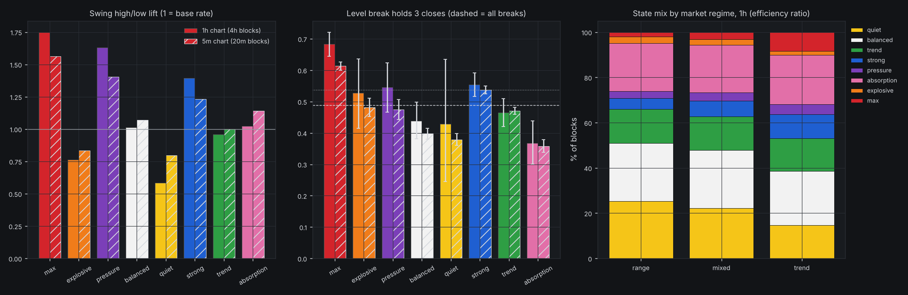
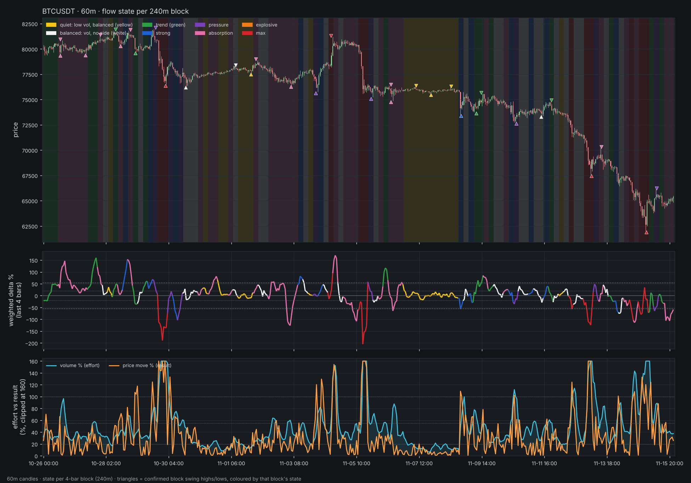
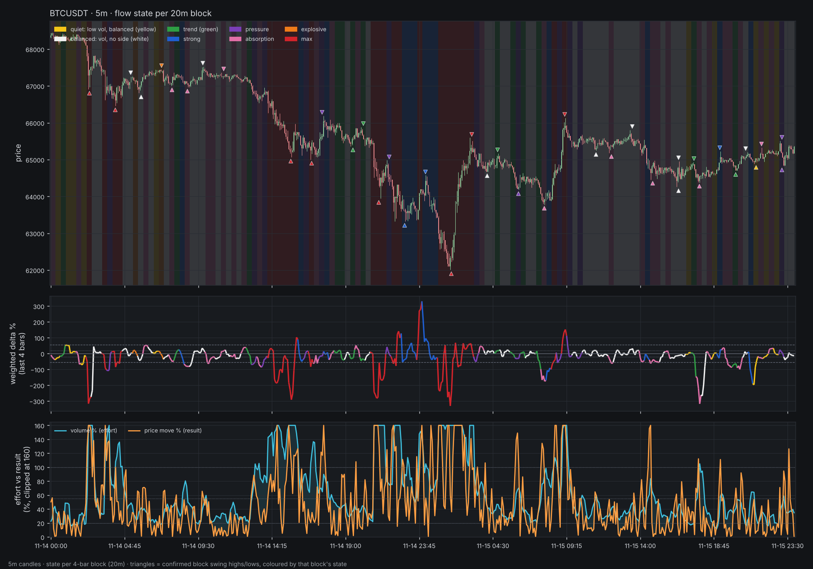

# FLOW STATE — وضعیت جریان سفارش، حجم در برابر قیمت

> ماژول: [`engine/flow_state.py`](../engine/flow_state.py) · فیلتر سیگنال: `SignalConfig.f_flow_state`
> و `--flow-veto` در CLI و CI · مطالعه‌ها: [`scripts/flow_state_study.py`](../scripts/flow_state_study.py)،
> [`scripts/flow_trade_attribution.py`](../scripts/flow_trade_attribution.py) · نمودارها:
> [`scripts/flow_state_charts.py`](../scripts/flow_state_charts.py) · MT5:
> [`mt5/TBAE_FlowState.mq5`](../mt5/TBAE_FlowState.mq5) و
> [`mt5/TBAE_EffortResult.mq5`](../mt5/TBAE_EffortResult.mq5) · اعداد خام: [`flow_state/`](flow_state/)
>
> داده: ۱ دقیقه‌ای بایننس، BTC/ETH/SOL/XRP، ۲۰۲۳-۱۱-۱۷ تا ۲۰۲۶-۱۱-۱۵ (≈۳ سال).
> چارت ۱ ساعته در بلوک‌های ۴ ساعته (۲۶٬۰۲۸ بلوک) و ۵ دقیقه‌ای در بلوک‌های ۲۰ دقیقه‌ای (۳۱۴٬۹۹۲ بلوک).

## ۱. روش

**دلتای وزنی:** `delta = 2 × taker_buy_volume − volume`. هر معامله با اندازه‌اش شمرده می‌شود.
تست `test_one_large_print_outweighs_many_small_ones` نشان می‌دهد ۹ خرید ریز در برابر یک فروش
بزرگ دلتای منفی می‌دهد. دلتای تیکی ساده آن را ۹ به ۱ به نفع خریدار می‌شمرد.

**درصدبندی:** حجم، |دلتا| و |حرکت| بر مرجع ۱۰۰٪ تقسیم می‌شوند. مرجع از ۳۰ روز بلوک‌های
**قبلی** ساخته می‌شود و علّی است. ۲٪ بالا به‌عنوان «مکس» کنار می‌رود و صدک ۹۸ بقیه ۱۰۰٪
است. یک جهش ۴۰۰ برابری درصد بلوک‌های بعدی را کمتر از ۵٪ جابه‌جا می‌کند.

**دسته‌بندی** (روی هر محور: ضعیف < ۲۰، متوسط، قوی ≥ ۵۵؛ دلتا «برابر» است وقتی |دلتا٪| < ۲۰):

| # | وضعیت | رنگ | قاعده |
|---|---|---|---|
| ۱ | مکس | قرمز | حجم٪ ≥ ۱۰۰ |
| ۲ | انفجاری | نارنجی | حجم زیر میانگین و حرکت٪ ≥ ۵۵ |
| | **دلتای برابر، هرگز روند نیست** | | |
| ۳ | پرفشار | بنفش | حجم قوی |
| ۴ | سفید (balanced) | سفید | حجم متوسط |
| ۵ | زرد (quiet) | زرد | حجم ضعیف |
| | **دلتای یک‌طرفه** | | |
| ۶ | قوی | آبی | قیمت دنبال دلتا رفته (حرکت٪ ≥ ۲۰، هم‌جهت) و حجم قوی |
| ۷ | روند نرمال | سبز | قیمت دنبال دلتا رفته و حجم ضعیف یا متوسط |
| ۸ | جذب (absorption) | صورتی | قیمت دنبال دلتا نرفته: طرف تهاجمی جذب شده است |

**دو اندیکاتور:**
- **خط جریان** میانگین دلتا٪ چهار میلهٔ آخر است و رنگ هر قطعه وضعیت بلوکش است.
- **حجم در برابر قیمت** دو خط موازی روی یک مقیاس است: خط فیروزه‌ای حجم٪ (تلاش) و خط نارنجی
  حرکت٪ (نتیجه)، هر دو برای چهار میلهٔ آخر.
  - هر دو بالا یعنی قوی، هر دو پایین یعنی زرد.
  - حجم بالای قیمت یعنی تلاش بی‌نتیجه (پرفشار یا جذب).
  - قیمت بالای حجم یعنی نتیجهٔ بی‌تلاش (انفجاری).
  - کراس‌ها جای تغییر وضعیت را نشان می‌دهند.

## ۲. سهم هر وضعیت (ادغام‌شده، پایدار در هر چهار نماد)

| | مکس | انفجاری | پرفشار | سفید | زرد | قوی | سبز | جذب |
|---|---:|---:|---:|---:|---:|---:|---:|---:|
| ۱h | ۴.۷٪ | ۲.۳٪ | ۳.۸٪ | ۲۵.۰٪ | ۲۰.۴٪ | ۷.۵٪ | ۱۴.۹٪ | ۲۱.۴٪ |
| ۵m | ۴.۴٪ | ۲.۸٪ | ۲.۱٪ | ۱۷.۳٪ | ۳۷.۱٪ | ۵.۰٪ | ۱۵.۱٪ | ۱۶.۱٪ |

## ۳. هر وضعیت کجای چارت است

### قله‌ها و دره‌ها
ضریب احتمال سقف یا کفِ تأییدشده (۲ بلوک در هر طرف) نسبت به نرخ پایه (≈۱۴٪):

| وضعیت | سقف ۱h | کف ۱h | سقف ۵m | کف ۵m |
|---|---:|---:|---:|---:|
| **پرفشار** | **×۱.۶۹** | **×۱.۵۷** | ×۱.۴۰ | ×۱.۴۱ |
| **مکس** | ×۱.۶۲ | **×۱.۸۷** | ×۱.۴۳ | ×۱.۷۰ |
| قوی | ×۱.۲۴ | ×۱.۵۴ | ×۱.۲۲ | ×۱.۲۴ |
| سفید | ×۱.۰۸ | ×۰.۹۵ | ×۱.۱۰ | ×۱.۰۴ |
| جذب | ×۱.۰۲ | ×۱.۰۲ | ×۱.۱۰ | ×۱.۱۸ |
| سبز | ×۰.۸۸ | ×۱.۰۴ | ×۰.۹۷ | ×۱.۰۳ |
| انفجاری | ×۰.۸۱ | ×۰.۷۲ | ×۰.۸۲ | ×۰.۸۵ |
| زرد | ×۰.۶۳ | ×۰.۵۳ | ×۰.۸۳ | ×۰.۷۷ |

بلوکِ **قبل** از سقف ×۱.۲۹ (۱h) و ×۱.۲۴ (۵m) بیشتر از حالت عادی انفجاری است. یعنی حرکت انفجاری
قیمت را به نقطه‌ای می‌رساند که بلوک بعدش برمی‌گردد. زرد تقریباً هیچ‌وقت سقف یا کف نیست.

> این بخش توصیفی است. قله فقط با دو بلوک **بعدی** تأیید می‌شود.

### حجم در برابر قیمت: فاصلهٔ دو خط قوی‌ترین نشانهٔ قله است
نرخ سقف یا کف (هر کدام) بر حسب فاصلهٔ حجم٪ − حرکت٪. میانگین ≈۲۷٪ (۱h) و ۲۶٪ (۵m) است.

| حالت دو خط | قله/دره ۱h | قله/دره ۵m | بلوک بعد > ۱ ATR (۱h) |
|---|---:|---:|---:|
| **حجم خیلی بالای قیمت (≥ ۴۰)** | **۴۵.۰٪** | **۴۱.۶٪** | ۱۸.۷٪ |
| هر دو بالا (≥ ۵۵) | ۳۸.۲٪ | ۳۳.۸٪ | ۱۹.۷٪ |
| حجم قیمت را رو به بالا کراس می‌کند | ۳۱.۵٪ | ۳۱.۸٪ | ۱۱.۷٪ |
| حجم کمی بالای قیمت | ۲۹.۴٪ | ۳۰.۳٪ | ۱۲.۷٪ |
| تقریباً برابر | ۲۲.۱٪ | ۲۳.۹٪ | ۸.۹٪ |
| قیمت حجم را رو به بالا کراس می‌کند | ۲۱.۹٪ | ۲۰.۸٪ | ۱۱.۲٪ |
| هر دو پایین (< ۲۰) | ۱۶.۰٪ | ۲۱.۶٪ | **۶.۴٪** |

وقتی **قیمت خیلی بالای حجم** است (حرکت بی‌حجم)، بلوک بعد ۵۵٪ [۵۲–۵۹] برعکس حرکت می‌کند.
این تأیید ضعیفی است برای «حرکت انفجاری برمی‌گردد».

### شکست سطوح (سقف یا کف ۲۰ بلوک قبل؛ «نگه داشت» = ۳ بستهٔ بعدی آن طرف سطح بمانند)

| وضعیت بلوکِ شکست | نگه داشت ۱h | نگه داشت ۵m |
|---|---:|---:|
| **مکس** | **۶۸٪** [۶۴–۷۲] | **۶۱٪** [۶۰–۶۳] |
| قوی | ۵۵٪ | ۵۴٪ |
| پرفشار | ۵۵٪ | ۴۸٪ |
| سبز | ۴۷٪ | ۴۷٪ |
| سفید | ۴۴٪ | ۴۰٪ |
| زرد | ۴۳٪ (n=۲۱) | ۳۸٪ |
| **جذب** | **۳۷٪** [۳۰–۴۴] | **۳۶٪** [۳۴–۳۸] |
| همهٔ شکست‌ها | ۵۴٪ (n=۲٬۳۹۶) | ۴۹٪ (n=۲۹٬۳۲۰) |
| قیمت بالای حجم هنگام شکست | ۶۰٪ | ۵۲٪ |
| حجم بالای قیمت هنگام شکست | ۴۷٪ | ۴۵٪ |
| دلتا هم‌جهت / خلاف شکست | ۵۵٪ / ۴۸٪ | ۵۰٪ / ۴۱٪ |

**شکست روی بلوک جذب بدترین است** و شکست کاذب را لو می‌دهد. **شکست با مکس بهترین است.**

### رنج و روند (نسبت کارایی ۶ بلوکی: کمتر از ۰.۲۵ رنج، بیشتر از ۰.۵ روند)

| رژیم | زرد+سفید ۱h | قوی ۱h | مکس ۱h | زرد+سفید ۵m |
|---|---:|---:|---:|---:|
| رنج | **۵۱٪** | ۴.۷٪ | ۱.۹٪ | **۶۰٪** |
| روند | ۳۹٪ | **۱۰.۵٪** | **۸.۳٪** | ۴۶٪ |

سبز در هر سه رژیم حدود ۱۵٪ است و جذب حدود ۲۱٪. هیچ‌کدام رژیم را از هم جدا نمی‌کنند. علتش این
است که این دو وضعیت درون یک بلوک تعریف می‌شوند، در حالی که رژیم ۶ بلوکی است.

## ۴. آنچه به سیستم اضافه شد: فیلتر «جریان»

هر معاملهٔ استراتژی (۲bp، استاپ ۴.۴σ، ۴ نماد، ۳ سال) به وضعیت **آخرین بلوکِ بسته‌شده قبل از
ورود** وصل شد. این کار علّی است. نمونه در زمان نصف شد (۲۰۲۴-۱۲-۱۹). قاعده روی نیمهٔ اول انتخاب
و روی نیمهٔ دوم آزمایش شد.

| وضعیت قبل از ورود | n | E[R] نیمهٔ اول | E[R] نیمهٔ دوم |
|---|---:|---:|---:|
| **سفید** | ۴۶۶ | **−۰.۰۹۰** | **−۰.۰۷۱** |
| انفجاری | ۵۷ | −۰.۱۲۳ | −۰.۰۸۳ |
| پرفشار | ۱۲۷ | +۰.۱۱۸ | +۰.۱۱۲ |
| مکس | ۱۳۷ | +۰.۱۴۴ | +۰.۰۴۴ |
| سبز | ۳۳۹ | +۰.۰۷۴ | −۰.۰۶۳ (ناپایدار) |

قانون انتخاب‌شده روی نیمهٔ اول: **ورود بعد از بلوک سفید یا انفجاری ممنوع.** این قانون به‌صورت
یک فیلتر سخت واقعی در موتور سیگنال اجرا شد (`--flow-veto balanced,explosive`)، نه با حذف
پس‌ازفاکتو، و بک‌تست کامل دوباره گرفته شد:

| | E[R] بدون فیلتر | **E[R] با فیلتر** | خالص بدون فیلتر | **خالص با فیلتر** |
|---|---:|---:|---:|---:|
| نیمهٔ اول | −۰.۰۰۲۲ | **+۰.۰۱۲۴** | −۱۱٬۵۴۱$ | −۵۷۶$ |
| **نیمهٔ دوم (آزمایش)** | −۰.۰۱۱۸ | **+۰.۰۱۲۳** | −۱۳٬۷۱۸$ | −۲٬۱۷۰$ |
| کل | −۰.۰۰۷۰ | **+۰.۰۱۲۳** | −۲۵٬۲۵۹$ | **−۲٬۷۴۷$** |

بهبود E[R] در نیمهٔ دوم برای هر نماد: BTC +۰.۰۲۸، ETH +۰.۰۴۴، SOL +۰.۰۷۰، XRP +۰.۰۳۳.
**هر چهار نماد خارج از نمونه بهتر شدند.**

**هشدارها:**
- بهبود +۰.۰۲R در هر معامله است. خطای معیار میانگین هر نیمه حدود ±۰.۰۲۵ است، پس یک نیمه به‌تنهایی
  معنادار نیست. استدلال اصلی این است که هر چهار نماد در دادهٔ آزمایشی هم‌جهت بهتر شده‌اند.
- BTC در نیمهٔ دوم با فیلتر ۲۶۶ معامله دارد و بدون فیلتر ۱۳۰. اجرای بدون فیلتر به سقف افت ۱۸٪
  رسید و kill-switch آن را متوقف کرد. پس بخشی از تفاوت BTC اثر همان توقف است.
- فیلتر پیش‌فرض **خاموش** است. نتایج قبلی و مطالعهٔ هفتگی CI تغییر نمی‌کنند.

## ۵. محدودیت‌ها و قدم بعدی

- آستانه‌ها (۲۰، ۵۵، ۱۰۰) همان آستانه‌های دسته‌بندی قیمتی موتورند و روی این داده تنظیم نشده‌اند.
- سبز و جذب درون یک بلوک تعریف شده‌اند و رژیم چندبلوکی را نمی‌بینند. نسخهٔ چندبلوکی کاندیدای بعدی است.
- پرفشار و مکس قبل از ورود مثبت بودند (+۰.۱۱ و +۰.۰۹R). ولی تقویت ورود بعد از آن‌ها هنوز آزمایش
  نشده است، فقط حذف سفید و انفجاری.
- کاندیدای بعدی ورود برگشتی است: «حجم خیلی بالای قیمت» در سقف یا کف (قله ×۱.۷) با تأیید جذب.

## ۶. بازتولید

```bash
cd tbae
python3 scripts/flow_state_study.py --tfs 60,5 --out ../reports/flow_state
pip install matplotlib && python3 scripts/flow_state_charts.py
for S in BTCUSDT ETHUSDT SOLUSDT XRPUSDT; do
  python3 -m app.cli backtest --feed csv:data/binance/${S}_1m.csv.gz --tf 60 --commission-bps 2 \
    --stop-mode sigma --stop-sigma 4.4 [--flow-veto balanced,explosive] --trades-csv trades/$S.csv
done
python3 scripts/flow_trade_attribution.py --trades-dir trades
python3 -m pytest tests/test_flow_state.py
```




