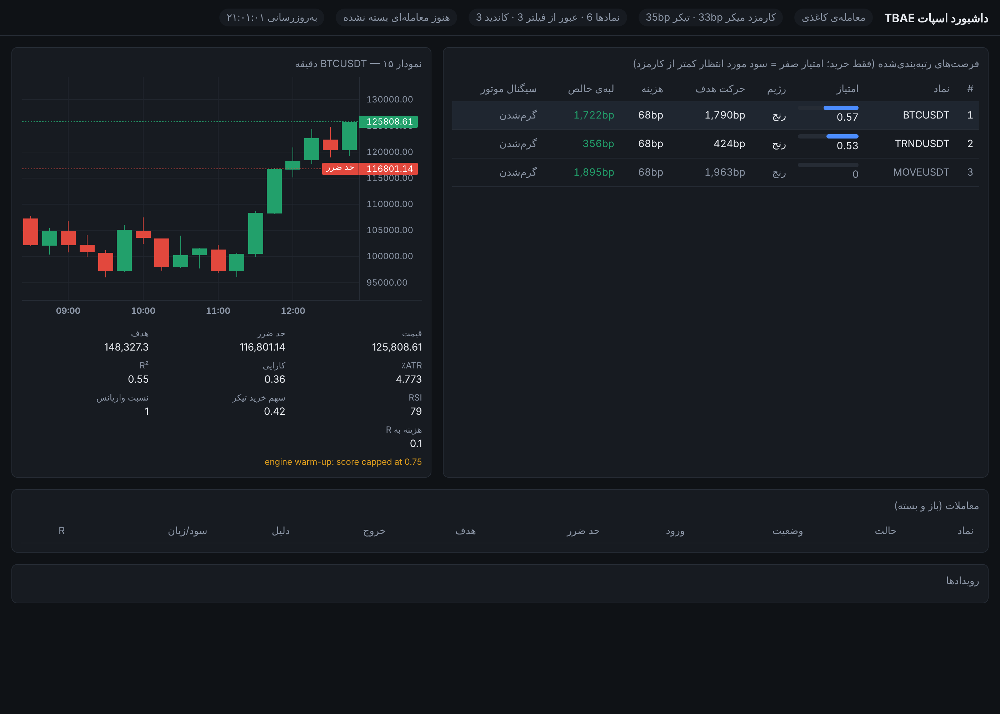

# سیستم زنده‌ی اسپات (`live/`)

اسکن زنده‌ی همه‌ی نمادهای صرافی، انتخاب کاندید، ساخت کندل، تحلیل DNA بازار،
رتبه‌بندی فرصت‌ها با در نظر گرفتن کارمزد، داشبورد وب و موتور ورود و خروج.



> تصویر بالا با **داده‌ی شبیه‌سازی‌شده** گرفته شده، نه داده‌ی واقعی تبدیل.

## معماری

| لایه | ماژول | کار |
|---|---|---|
| EXCHANGE API | `live/exchange/` | اتصال مستقیم به تبدیل (`tabdeal.py`)، و CCXT برای صرافی‌های دیگر (`ccxt_adapter.py`) |
| MARKET DATA ENGINE | `live/market_data.py` | گرفتن معاملات و دفتر سفارش همه‌ی نمادها، به‌صورت چرخشی |
| ALL SYMBOLS SCANNER | `live/scanner.py` | یک ردیف آماری برای هر نماد: حجم، دامنه، اسپرد، عمق، جریان خرید |
| PRELIMINARY FILTER | `live/filters.py` | رد نمادهایی که اسپرد، عمق یا دامنه‌شان کارمزد را پوشش نمی‌دهد (دلیل هر رد ثبت می‌شود) |
| CANDIDATE SELECTOR | `live/selector.py` | N نماد برتر، با پسماند (hysteresis) تا فهرست مدام عوض نشود |
| LIVE CANDLE ENGINE | `live/candles.py` | تبدیل معاملات به کندل ۱ دقیقه‌ای و ذخیره در SQLite |
| MARKET DNA ANALYZER | `live/dna.py` | ویژگی‌های pandas/NumPy به‌علاوه‌ی موتور اصلی tbae (پس از گرم‌شدن) |
| OPPORTUNITY RANKING | `live/ranking.py` | امتیاز ۰ تا ۱. اگر حرکت مورد انتظار از ۳ برابر هزینه کمتر باشد، امتیاز **صفر** است |
| SPOT DASHBOARD | `live/dashboard.py` | FastAPI و یک صفحه‌ی فارسی، بدون وابستگی به CDN |
| ENTRY / EXIT ENGINE | `live/execution.py` | پیش‌فرض: معامله‌ی کاغذی. حالت واقعی دو قفل دارد |

## واقعیت‌های API تبدیل که طراحی را شکل داده‌اند

* **API تبدیل کندل تاریخی ندارد.** تاریخچه‌ی کندل خود تبدیل فقط با جمع‌آوری مداوم
  معاملات ساخته می‌شود، پس سرور باید **۲۴ ساعته روشن** باشد.
* `trades` فقط ۱۰۰۰ معامله‌ی آخر را می‌دهد و راهی برای گرفتن معاملات قدیمی‌تر ندارد.
  اگر بین دو درخواست بیش از ۱۰۰۰ معامله انجام شود، بخشی از داده از دست می‌رود. سیستم
  این را تشخیص می‌دهد (رویداد `gap`) و کاندیدها را زودتر از بقیه می‌پرسد.
* وب‌سوکت اسپات فقط دفتر سفارش را، هر ۲ ثانیه یک بار، می‌دهد.
* CCXT از تبدیل و بقیه‌ی صرافی‌های ایرانی پشتیبانی نمی‌کند، برای همین اتصال به تبدیل
  مستقیم نوشته شده. CCXT برای صرافی‌های دیگر و برای پرکردن تاریخچه‌ی جفت‌های USDT
  (مثلاً از Binance) به کار می‌رود: `"history_exchange": "binance"`. تاریخچه‌ای که
  از صرافی دیگر می‌آید هیچ‌وقت روی کندل‌های واقعی تبدیل نوشته نمی‌شود.
* موتور tbae برای سیگنال کامل در تایم‌فریم ۱۵ دقیقه حدود **۶۵ ساعت** داده لازم دارد.
  تا آن موقع امتیاز هر نماد حداکثر ۰.۷۵ است.

## کارمزد

کارمزد پایه‌ی تبدیل حدود ۰.۳۳٪ (میکر) و ۰.۳۵٪ (تیکر) برای هر طرف معامله است.
سیستم کارمزد واقعی حساب را با `GET /r/api/v1/account` می‌خواند و جایگزین مقدار
پیش‌فرض می‌کند. همه‌ی ورودها سفارش محدود (میکر) هستند. نتیجه‌ی عملی: در تایم‌فریم‌های
کوتاه، بیشتر نمادها از فیلتر `range_vs_fees` رد می‌شوند. این رفتار عمدی است.

## راه‌اندازی روی سرور

```bash
cd tbae
python3 -m venv .venv && . .venv/bin/activate
pip install -r requirements.txt

python3 -m live default-config > live.json      # تنظیمات را ویرایش کن
python3 -m live check --config live.json         # اتصال، تعداد بازارها، کارمزد حساب
python3 -m live scan-once --config live.json     # یک دور کامل و چاپ قیف فیلترها
python3 -m live run --config live.json --dashboard   # داشبورد روی http://127.0.0.1:8100
```

برای اجرای دائمی روی لینوکس `deploy/tbae-live.service` (systemd) و روی ویندوز [`WINDOWS.md`](WINDOWS.md) را ببین.

**کلیدها** فقط در متغیر محیطی قرار می‌گیرند: `TABDEAL_API_KEY` و `TABDEAL_API_SECRET`.
برای اسکن و معامله‌ی کاغذی **هیچ کلیدی لازم نیست**. اگر کلیدی دسترسی برداشت داشته
باشد، سیستم هشدار می‌دهد.

**داشبورد** هیچ احراز هویتی ندارد و پیش‌فرض فقط روی `127.0.0.1` باز است. برای دیدنش
از راه دور از تونل SSH (`ssh -L 8100:127.0.0.1:8100 server`) یا nginx با رمز عبور
استفاده کن. هیچ‌وقت آن را مستقیم روی اینترنت باز نکن.

## معامله‌ی واقعی

برای فعال شدن معامله‌ی واقعی **هر دو** شرط زیر لازم است:

1. در فایل تنظیمات: `"execution": {"mode": "live"}`
2. در محیط سرور: `TBAE_LIVE_TRADING=yes`

با این کار، یک فایل تنظیمات که از جای دیگری کپی شده به‌تنهایی نمی‌تواند سفارش واقعی ثبت کند.

**محدودیت مهم:** حد ضرر را همین برنامه اجرا می‌کند، نه صرافی. اگر سرور یا برنامه از
کار بیفتد و قیمت از حد ضرر رد شود، هیچ فروشی انجام نمی‌شود. تا وقتی نتایج معامله‌ی
کاغذی بررسی نشده، حالت واقعی را روشن نکن و حجم معاملات را کوچک نگه دار. استفاده از
سفارش OCO خود تبدیل برای حد ضرر سمت صرافی، قدم بعدی است.

## تست‌ها

`tests/test_live.py` کاملاً آفلاین است. نمونه‌پاسخ‌ها از مستندات تبدیل کپی شده‌اند، امضای
HMAC جداگانه با الگوریتم SDK رسمی مقایسه می‌شود، و یک صرافی شبیه‌سازی‌شده کل زنجیره را
از دریافت داده تا داشبورد اجرا می‌کند.
