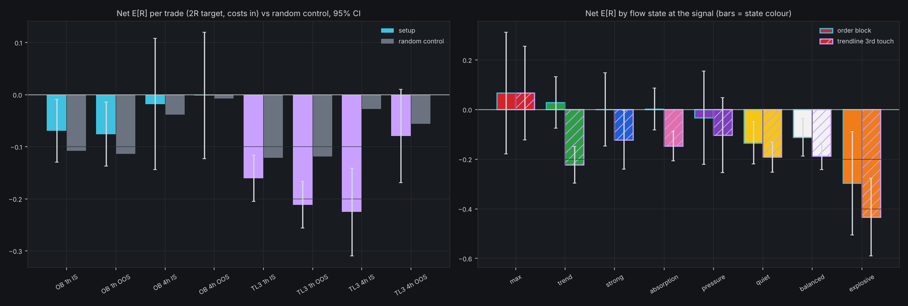
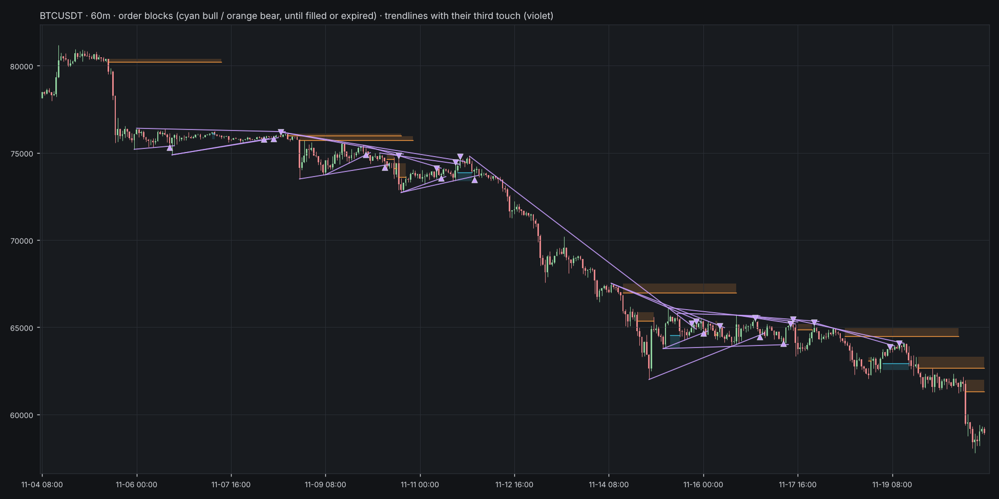

# SETUPS — اوردر بلاک و نقطهٔ سوم خط روند

> تشخیص: [`engine/structure_setups.py`](../engine/structure_setups.py) · بک‌تست:
> [`scripts/setup_backtest.py`](../scripts/setup_backtest.py) · نمودار:
> [`scripts/setup_charts.py`](../scripts/setup_charts.py) · تست:
> [`tests/test_structure_setups.py`](../tests/test_structure_setups.py) · اعداد خام:
> [`setups/setup_backtest.json`](setups/setup_backtest.json)
>
> داده: ۱ دقیقه‌ای بایننس، BTC/ETH/SOL/XRP، ۲۰۲۳-۱۱-۲۲ تا ۲۰۲۶-۱۱-۲۰. چارت ۱ و ۴ ساعته.
> نیمهٔ اول تا ۲۰۲۵-۰۵-۲۲ و نیمهٔ دوم از آن به بعد.

## ۱. قواعد (از پیش تعیین شده، روی این داده تنظیم نشده)

**اوردر بلاک صعودی:**
- **شکست ساختار:** اولین بستهٔ بالای آخرین سقفِ سوئینگِ *تأییدشده*. سوئینگ با قدرت ۳ فقط ۳ کندل بعد معلوم است.
- **کندل بلاک:** آخرین کندل نزولی در ۱۰ کندل قبل از شکست.
- **حرکت ضربه‌ای:** بستهٔ کندل شکست منهای کفِ بلاک ≥ ۱.۵ ATR.
- **ورود:** سفارش لیمیت روی **لبهٔ بالای بلاک**، فقط برای **اولین بازگشت** قیمت، حداکثر ۴۸ کندل.
- **استاپ:** ۰.۱ ATR زیر کف بلاک. **تارگت:** ۲R. **خروج زمانی:** بعد از ۴۸ کندل.
- اوردر بلاک نزولی قرینهٔ همین است.

**نقطهٔ سوم خط روند (خرید):**
- **خط:** از دو کفِ سوئینگِ تأییدشده و بالارونده با حداقل ۵ کندل فاصله کشیده می‌شود.
- **اعتبار خط:** بین دو کف هیچ بسته‌ای زیر خط نباشد و هیچ کفی بیش از ۰.۲۵ ATR آن را نشکافد.
- **دور شدن:** بعد از تأیید کفِ دوم، قیمت باید دست‌کم ۱ ATR بالای خط بسته شود.
- **برخورد سوم:** اولین کندلی که کفش تا ۰.۲۵ ATR به خط برسد و **بالای خط بسته شود**.
- **ورود:** مارکت در باز شدن کندل بعد.
- **استاپ:** ۰.۳ ATR زیر کفِ آن کندل یا زیر خط، هر کدام پایین‌تر. **تارگت:** ۲R.
- هر خط فقط یک بار معامله می‌شود. بسته شدن زیر خط آن را باطل می‌کند. خط بعد از ۲۰۰ کندل منقضی می‌شود.
- خط مقاومت نزولی برای فروش قرینهٔ همین است.

**شبیه‌سازی:**
- پر شدن سفارش و خروج روی **کندل‌های ۱ دقیقه‌ای** حل می‌شود. اگر یک دقیقه هم استاپ و هم تارگت را لمس کند، استاپ حساب می‌شود.
- **هزینه:** سفارش لیمیت و تارگت ۱bp. ورود مارکت، استاپ و خروج زمانی ۲bp کارمزد به‌اضافهٔ ۲bp لغزش.
- **کنترل:** برای هر ستاپ ۳ ورود تصادفی ساخته می‌شود، با همان جهت، همان فاصلهٔ استاپ بر حسب ATR، همان خروج‌ها و در همان نیمهٔ داده.

## ۲. نتیجه (E[R] خالص هر معامله، تارگت ۲R)

| ستاپ | TF | n | E[R] | برد٪ | PF | کنترل تصادفی | **لبه نسبت به کنترل** |
|---|---|---:|---:|---:|---:|---:|---:|
| اوردر بلاک | ۱h | ۴٬۱۷۲ | −۰.۰۷۳ ±۰.۰۲۲ | ۳۳.۵ | ۰.۹۰ | −۰.۱۱۱ | **+۰.۰۳۸** |
| اوردر بلاک | ۴h | ۱٬۰۱۲ | −۰.۰۱۰ ±۰.۰۴۵ | ۳۴.۴ | ۰.۹۹ | −۰.۰۲۳ | +۰.۰۱۳ |
| نقطهٔ سوم خط روند | ۱h | ۷٬۷۳۱ | **−۰.۱۸۶** ±۰.۰۱۶ | ۳۱.۸ | ۰.۷۶ | −۰.۱۲۱ | **−۰.۰۶۶** |
| نقطهٔ سوم خط روند | ۴h | ۱٬۹۳۱ | **−۰.۱۵۳** ±۰.۰۳۱ | ۳۰.۵ | ۰.۷۹ | −۰.۰۴۲ | **−۰.۱۱۱** |

لبهٔ اوردر بلاک در ۱h در هر دو نیمه یکی است: +۰.۰۳۸ و +۰.۰۳۷. نقطهٔ سوم در هر دو نیمه، هر دو تایم‌فریم و
هر چهار نماد منفی است. زیان آن از هزینه نیست، چون حتی قبل از هزینه منفی است. تغییر تارگت به ۱R یا
۳R تصویر را عوض نمی‌کند: نقطهٔ سوم در ۱h بین −۰.۱۶ و −۰.۱۹ و در ۴h بین −۰.۱۴ و −۰.۱۷ می‌ماند. با فقط
یک معاملهٔ باز در هر لحظه هم نتیجه همین است.

**جزئیات اوردر بلاک:**

| | ۱h | ۴h |
|---|---:|---:|
| بلاک صعودی | −۰.۰۳۷ (لبه +۰.۰۸۷) | **+۰.۰۴۲** (PF ۱.۰۶) |
| بلاک نزولی | −۰.۱۱۱ | −۰.۰۷۰ |

بلاک صعودی ۴ ساعته با فیلتر جریان در هر دو نیمه مثبت است: +۰.۰۹۸ و +۰.۰۴۹ (n≈۱۷۶ در هر نیمه).
ولی خطای معیار ±۰.۱۱ است و انتخاب «فقط صعودی و ۴ ساعته» بعد از دیدن داده انجام شده. پس این یک
**کاندید** است، نه نتیجه.

## ۳. آزمون مستقل فیلتر جریان (balanced, explosive)

این فیلتر روی استراتژی TBAE انتخاب شده بود. ستاپ‌های این فایل هیچ نقشی در انتخابش نداشتند.

| ستاپ | نیمه | E[R] معامله‌های حذف‌شده | E[R] معامله‌های ماندگار | تفاوت |
|---|---|---:|---:|---:|
| اوردر بلاک | اول | −۰.۱۰۴ | −۰.۰۴۴ | +۰.۰۶۱ |
| اوردر بلاک | دوم | −۰.۱۵۷ | −۰.۰۲۲ | **+۰.۱۳۵** |
| خط روند | اول | −۰.۱۸۲ | −۰.۱۷۱ | +۰.۰۱۱ |
| خط روند | دوم | −۰.۲۳۶ | −۰.۱۶۴ | +۰.۰۷۲ |

در هر چهار ردیف، معامله‌هایی که فیلتر حذف می‌کند بدترند. ستاپ‌ها در وضعیت **مکس** بهترین هستند
(+۰.۰۶۶ برای هر دو) و در وضعیت **انفجاری** بدترین (−۰.۳۰ و −۰.۴۴).

## ۴. خوانش

- **اوردر بلاک** اطلاعات دارد و از ورود تصادفی بهتر است. ولی با قواعد کلاسیک و تارگت ثابت، بعد از هزینه
  سودده نیست. جای امیدوارکننده‌اش بلاک صعودی ۴ ساعته همراه با فیلتر جریان است.
- **نقطهٔ سوم خط روند** به‌عنوان ورودِ برگشت از خط کار نمی‌کند و از ورود تصادفی هم بدتر است. برخورد
  سوم بیشتر به شکستن خط ختم می‌شود تا برگشت از آن. فرضیهٔ معکوس، یعنی معاملهٔ شکستِ خط بعد از برخورد
  سوم، باید با قاعدهٔ از پیش تعیین‌شده و روی دادهٔ تازه آزموده شود. معکوس کردن همین نتیجه overfit است.




## ۵. بازتولید

```bash
cd tbae
python3 scripts/setup_backtest.py --tfs 60,240 --out ../reports/setups      # ≈ ۲ دقیقه
pip install matplotlib && python3 scripts/setup_charts.py
python3 -m pytest tests/test_structure_setups.py
```
